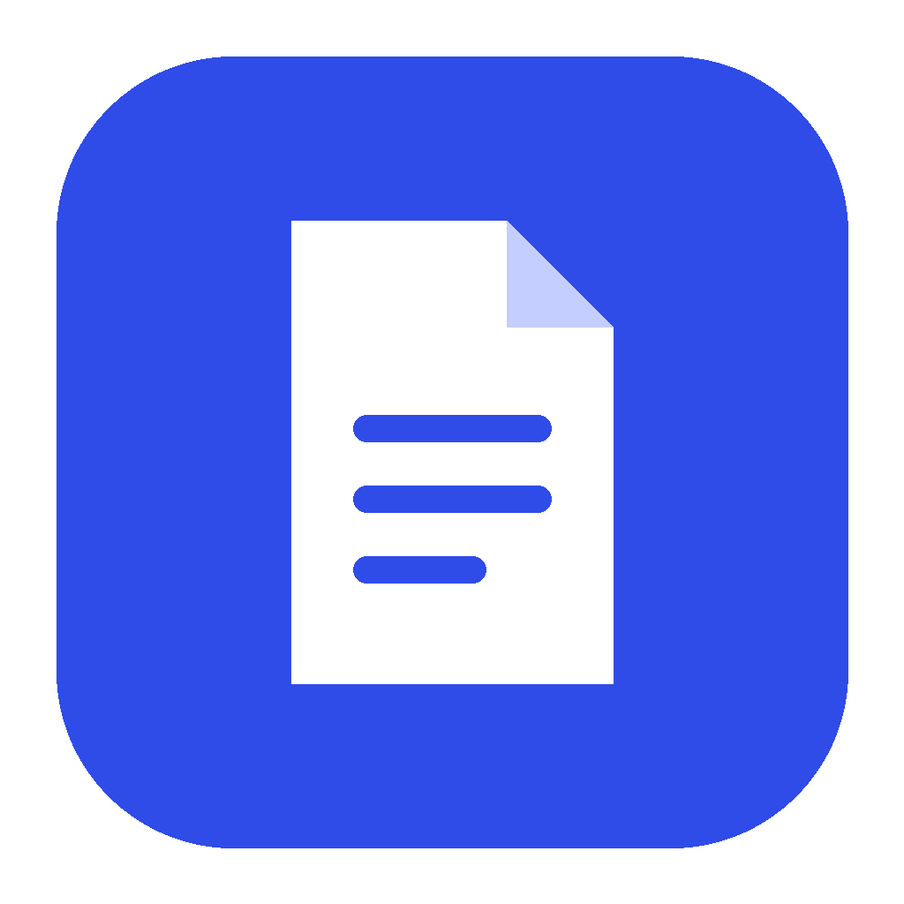
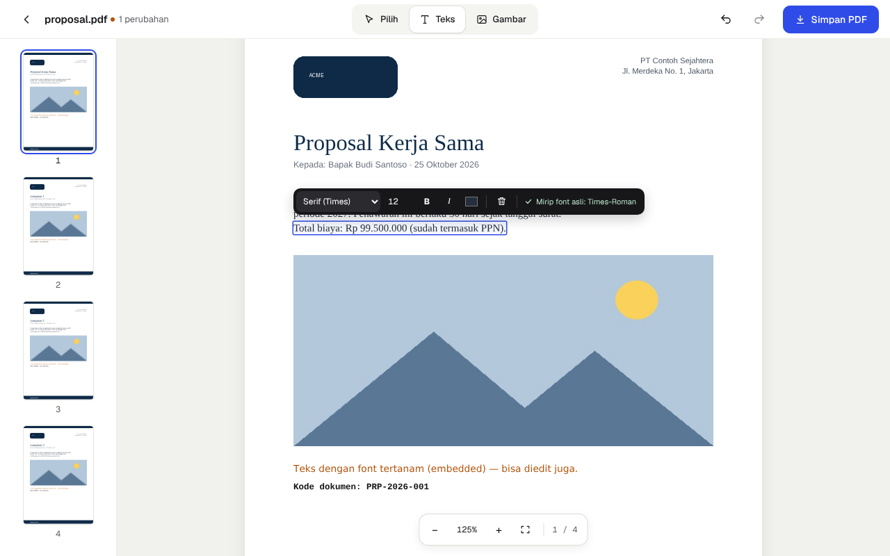
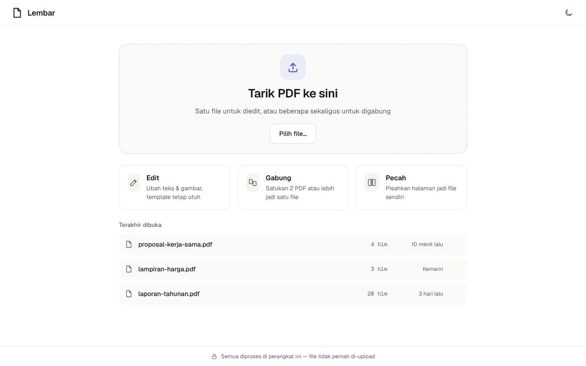
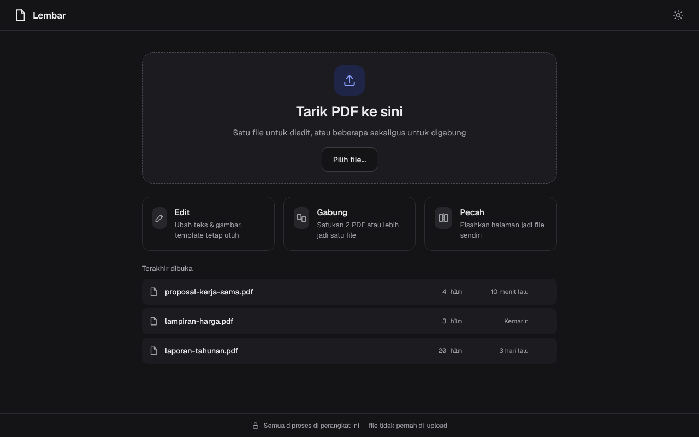
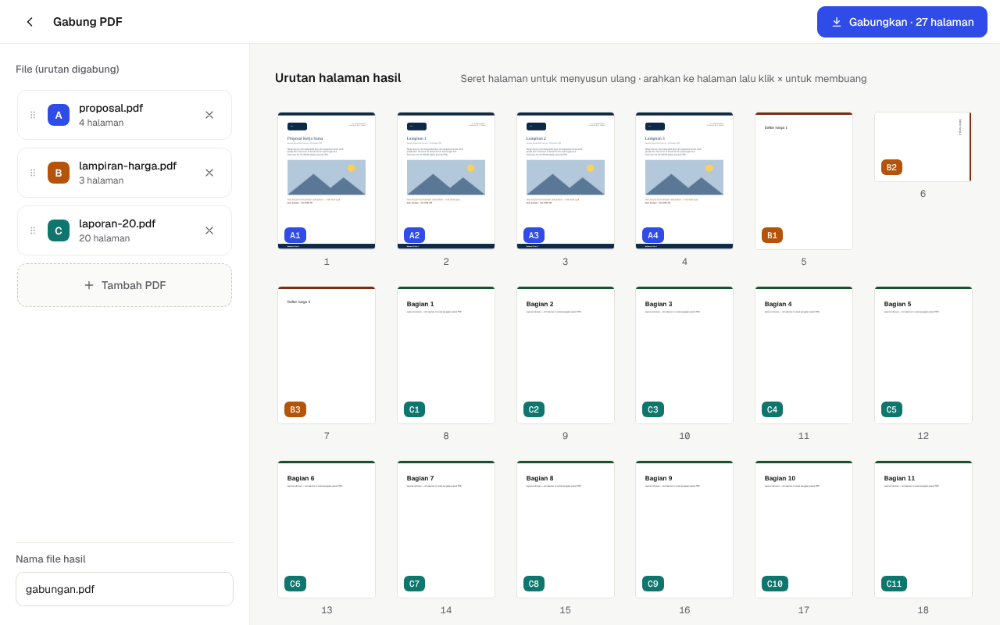
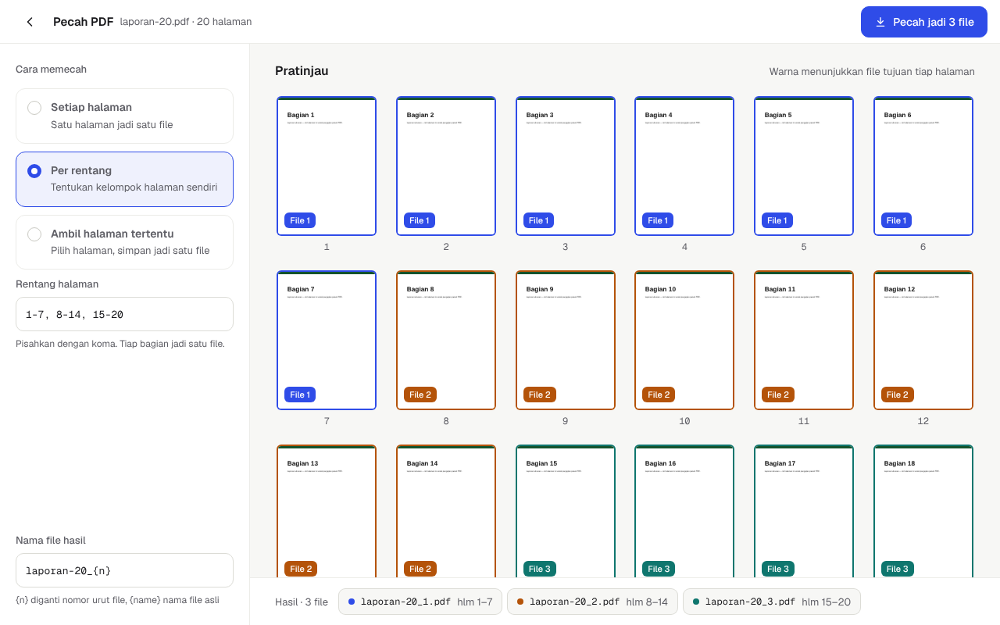

<p align="center">
  
</p>

<h1 align="center">Lembar</h1>

<p align="center">
  Aplikasi desktop sederhana untuk <b>mengedit teks &amp; gambar di PDF tanpa merusak template</b>,<br>
  <b>menggabungkan</b> beberapa PDF jadi satu, dan <b>memecah</b> PDF jadi file terpisah.<br>
  Dibuat dengan Rust + Tauri. Semua diproses di komputer Anda — file tidak pernah di-upload.
</p>

<p align="center">
  
</p>

## Fitur

- **Tarik, edit, simpan.** Tarik PDF ke jendela, klik teks yang mau diubah, ketik, lalu *Simpan PDF*.
- **Edit teks di tempatnya.** Teks baru diletakkan tepat di garis dasar teks asli, dengan ukuran, warna, tebal/miring, dan jenis huruf (serif / sans / mono) yang mengikuti aslinya. Bagian lain halaman tidak disentuh.
- **Hapus atau tambah teks.** Hapus satu baris, atau klik area kosong untuk menambah teks baru.
- **Ganti gambar tanpa merusak tata letak.** Gambar pengganti otomatis dipotong (*crop*) mengikuti kotak gambar lama, jadi posisinya tidak bergeser. Bisa juga menambah gambar baru (JPG, PNG, WebP, GIF, BMP) lalu menggeser dan mengubah ukurannya.
- **Gabung PDF.** Susun urutan file, seret halaman untuk mengatur ulang, buang halaman yang tidak perlu.
- **Pecah PDF.** Per halaman, per rentang (`1-3, 5, 8-`), atau ambil halaman tertentu saja. Nama file hasil bisa diatur (`{name}_{n}`).
- **Banyak file sekaligus.** Tarik beberapa PDF, lalu pilih: gabung jadi satu, edit satu per satu, atau pecah tiap file.
- **PDF berpassword** bisa dibuka setelah Anda memasukkan kata sandinya.
- **Urungkan/ulangi**, zoom, mode gelap, dan daftar file terakhir.
- **Aman.** File asli tidak pernah ditimpa kecuali Anda sendiri memilih nama yang sama. Penulisan file bersifat atomik, jadi tidak ada PDF setengah jadi kalau terjadi gangguan.

<p align="center">
  
  
  
  
</p>

## Instalasi

### Cara termudah: unduh installer

Buka halaman [**Releases**](https://github.com/haloabdur/custom-pdf/releases), lalu unduh sesuai sistem operasi:

| Sistem | File | Catatan |
| --- | --- | --- |
| Windows 10/11 | `Lembar_1.0.0_x64-setup.exe` atau `.msi` | Jika muncul *Windows protected your PC*, klik **More info → Run anyway** (aplikasi belum ditandatangani sertifikat). |
| macOS 11+ (Intel & Apple Silicon) | `Lembar_1.0.0_universal.dmg` | Seret ke *Applications*. Saat pertama kali dibuka, klik kanan → **Open** (aplikasi belum dinotarisasi). Jika tetap diblokir: `xattr -dr com.apple.quarantine /Applications/Lembar.app` |
| Ubuntu / Debian | `Lembar_1.0.0_amd64.deb` | `sudo apt install ./Lembar_1.0.0_amd64.deb` |
| Fedora / openSUSE | `Lembar-1.0.0-1.x86_64.rpm` | `sudo dnf install ./Lembar-1.0.0-1.x86_64.rpm` |
| Linux lain | `Lembar_1.0.0_amd64.AppImage` | `chmod +x Lembar_*.AppImage` lalu jalankan. |

Setelah terpasang, Lembar juga muncul di menu **Open with…** untuk file PDF.

> **Membuat installer sendiri lewat GitHub:** buat tag versi lalu push, misalnya
> `git tag v1.0.0 && git push origin v1.0.0`. Workflow [`release.yml`](.github/workflows/release.yml)
> akan membangun installer untuk ketiga sistem operasi dan menaruhnya di *draft release*. Periksa lalu klik **Publish**.

### Membangun dari source code

1. **Pasang Rust** (versi 1.90 atau lebih baru): <https://rustup.rs>
2. **Pasang kebutuhan sistem** untuk Tauri:
   - **Windows:** [Microsoft C++ Build Tools](https://visualstudio.microsoft.com/visual-cpp-build-tools/) (pilih *Desktop development with C++*). WebView2 sudah ada di Windows 10/11.
   - **macOS:** `xcode-select --install`
   - **Ubuntu/Debian:**
     ```sh
     sudo apt update
     sudo apt install libwebkit2gtk-4.1-dev build-essential curl wget file \
       libxdo-dev libssl-dev libayatana-appindicator3-dev librsvg2-dev
     ```
   - **Fedora:**
     ```sh
     sudo dnf install webkit2gtk4.1-devel openssl-devel curl wget file \
       libappindicator-gtk3-devel librsvg2-devel libxdo-devel
     sudo dnf group install "c-development"
     ```
3. **Pasang Tauri CLI:**
   ```sh
   cargo install tauri-cli --version "^2" --locked
   ```
4. **Jalankan atau bangun:**
   ```sh
   git clone https://github.com/haloabdur/custom-pdf.git
   cd custom-pdf

   cargo tauri dev     # jalankan dalam mode pengembangan
   cargo tauri build   # buat installer untuk sistem Anda
   ```
   Installer hasil `cargo tauri build` ada di `target/release/bundle/`
   (`msi/` dan `nsis/` di Windows, `dmg/` dan `macos/` di macOS, `deb/`, `rpm/`, `appimage/` di Linux).

Tidak perlu Node.js atau npm: antarmuka berupa HTML/CSS/JavaScript biasa di folder `ui/`, dan semua pustaka (pdf.js, font Geist) sudah disertakan.

## Cara pakai

| Aksi | Cara |
| --- | --- |
| Buka PDF | Tarik file ke jendela, klik area *Tarik PDF ke sini*, atau pilih dari *Terakhir dibuka* |
| Edit teks | Alat **Teks** (`T`) → klik teks → ketik. `Esc` untuk selesai |
| Tambah teks | Alat **Teks** → klik area kosong |
| Hapus teks | Klik teks → ikon tempat sampah di toolbar |
| Ganti gambar | Alat **Gambar** (`G`) → klik gambar → pilih file |
| Tambah gambar | Alat **Gambar** → klik area kosong → pilih file |
| Geser / ubah ukuran | Alat **Pilih** (`V`) → seret; tarik sudut kanan bawah gambar |
| Urungkan / ulangi | `Ctrl+Z` / `Ctrl+Shift+Z` (`⌘` di macOS) |
| Simpan / simpan sebagai | `Ctrl+S` / `Ctrl+Shift+S` |
| Zoom | `Ctrl` + scroll, `Ctrl +` / `Ctrl −`, `Ctrl 0` untuk sesuaikan lebar |

## Cara kerja dan batasan

Lembar **tidak menulis ulang** isi halaman. Saat menyimpan:

- isi halaman asli dibiarkan apa adanya (dibungkus `q … Q`);
- untuk teks yang diedit, area teks lama ditutup dengan warna latar yang diambil dari halaman itu sendiri, lalu teks baru ditulis di posisi, ukuran, dan warna yang sama;
- gambar yang diganti ditukar langsung di objek gambarnya, sehingga semua tempat yang memakai gambar itu ikut berubah dengan ukuran kotak yang sama.

Karena itu template, tata letak, dan elemen lain tetap utuh. Beberapa hal yang perlu diketahui:

- **Font.** Teks hasil edit memakai font standar PDF yang paling mirip (Helvetica, Times, atau Courier, dengan varian tebal/miring). Font asli yang tertanam di PDF biasanya hanya berisi huruf yang dipakai, jadi tidak bisa dipakai ulang dengan aman. Toolbar menampilkan nama font aslinya sebagai acuan.
- **Karakter.** Font standar mendukung huruf Latin (termasuk é, ü, €, “ ” dan –). Karakter di luar itu (mis. aksara Arab, CJK, emoji) akan tampil sebagai `?`; Lembar memberi peringatan sebelum menyimpan.
- **Satu baris per edit.** Teks dikenali per baris. Paragraf panjang diedit baris demi baris; tekan `Enter` di dalam kotak untuk menambah baris.
- **PDF hasil scan** (halaman berupa foto) tidak punya teks yang bisa diedit, tetapi bisa ditambah teks atau gambar di atasnya.
- **Tanda tangan digital** pada PDF menjadi tidak valid setelah file diubah. Ini sifat semua editor PDF.
- **Kata sandi.** PDF berpassword yang dibuka dengan kata sandi disimpan **tanpa** kata sandi.
- **Formulir dan bookmark** tetap ada saat mengedit. Saat menggabung atau memecah, bookmark dan formulir interaktif tidak ikut dibawa.

## Struktur proyek

```
crates/lembar-core/   Mesin PDF (Rust, tanpa UI): gabung, pecah, deteksi gambar, edit teks & gambar
  src/compose.rs      Menyusun dokumen baru dari halaman-halaman dokumen lain (gabung/pecah/urutkan)
  src/edit.rs         Menulis edit teks, penggantian gambar, dan gambar baru ke halaman
  src/images.rs       Menemukan gambar di tiap halaman beserta kotaknya; encode gambar baru
  tests/              Tes ujung-ke-ujung
src-tauri/            Aplikasi desktop Tauri: perintah buka/simpan/gabung/pecah dan dialog file
ui/                   Antarmuka (HTML/CSS/JS tanpa build step)
  js/screens/         Beranda, banyak file, editor, gabung, pecah
  vendor/             pdf.js (render halaman) dan font Geist
.github/workflows/    CI dan pembuatan installer otomatis
```

## Pengembangan

```sh
cargo test --workspace                          # semua tes
cargo clippy --workspace --all-targets -- -D warnings
cargo fmt --all
```

Pustaka `lembar-core` bisa dipakai sendiri di proyek Rust lain:

```rust
use lembar_core::{compose, load, save, PageRef, Source};

let a = load(Source::new(&std::fs::read("a.pdf")?))?;
let b = load(Source::new(&std::fs::read("b.pdf")?))?;
// Halaman 1 dari b, lalu semua halaman a
let mut order = vec![PageRef::new(1, 0)];
order.extend((0..a.get_pages().len() as u32).map(|p| PageRef::new(0, p)));
let mut merged = compose(vec![a, b], &order)?;
std::fs::write("gabungan.pdf", save(&mut merged)?)?;
```

## Lisensi

[MIT](LICENSE) © 2026 Abdurrahman Trimanto.

Komponen pihak ketiga yang disertakan:
[pdf.js](https://github.com/mozilla/pdf.js) (Apache-2.0, lihat `ui/vendor/pdfjs/LICENSE`),
font [Geist](https://github.com/vercel/geist-font) (SIL Open Font License 1.1, lihat `ui/vendor/fonts/OFL.txt`).
